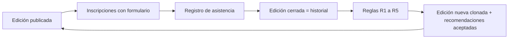
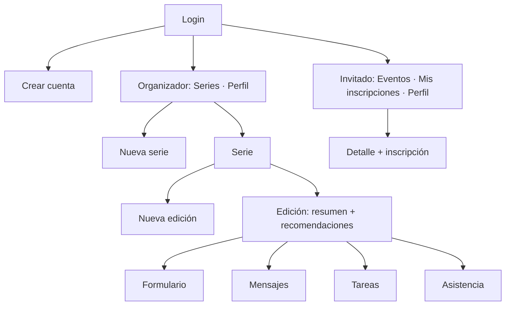
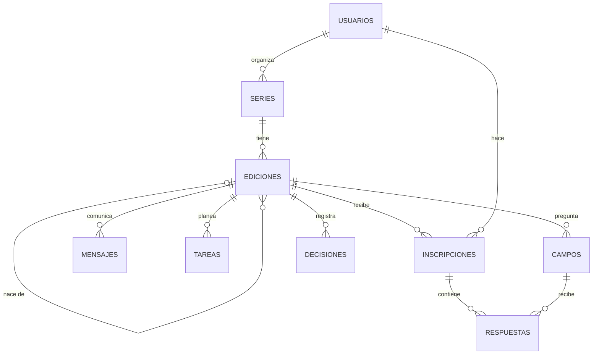
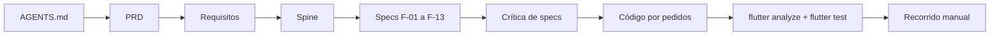

# ProyectoSeminarioAlvaro · Operación inteligente de eventos recurrentes

> La siguiente edición de tu evento, armada a partir de la anterior y de lo que aprendiste en ella.

Proyecto del Seminario de Ingeniería de Software · Universidad Icesi · 2026-2.

## 1. El reto

Las organizaciones que hacen eventos recurrentes reconstruyen en cada edición formularios, comunicaciones, configuraciones y tareas operativas. El reto pide explorar cómo una plataforma puede **aprovechar la información de eventos anteriores** para anticipar necesidades, recomendar acciones y reducir el trabajo manual de cada edición nueva. Referencia del sector: [Peewah](https://peewah.co), plataforma de operación de eventos para educación continua que ya permite clonar un evento pasado.

## 2. Contexto (entrega 1, máximo 150 palabras)

ProyectoSeminarioAlvaro es una app para las organizaciones que repiten eventos —charlas mensuales, talleres trimestrales, cursos de educación continua— y que en cada edición vuelven a armar el formulario de inscripción, los mensajes, el cupo y la lista de tareas. Con ProyectoSeminarioAlvaro, el organizador crea la siguiente edición copiando la anterior, y las fechas de tareas y mensajes se recalculan solas con la fecha nueva. Además, la app revisa las ediciones pasadas y le recomienda, con evidencia, qué cupo abrir, qué tareas adelantar, qué preguntas quitar, a quién invitar y cuánta gente esperar. Desde el celular, el invitado ve los eventos abiertos, se inscribe y recibe un código. El día del evento, el organizador lo busca por nombre o código y marca su asistencia, que alimenta las recomendaciones de la edición siguiente.

## 3. La propuesta: un ciclo que aprende

Cada evento es una **serie** y cada vez que se hace es una **edición**. Lo que pasa en una edición alimenta la siguiente:



| Rol | Dónde | Qué hace |
|---|---|---|
| Organizador | PC, en el navegador | Crea series y ediciones, revisa recomendaciones, maneja formulario, mensajes, tareas y asistencia. |
| Invitado | Celular Android | Ve eventos publicados, se inscribe, consulta su código y su historial. |

Un solo código Flutter para los dos. En el PC el contenido se centra con un ancho máximo de 600 px.

## 4. La lógica (lo que hace inteligente a la app)

No hay modelo de IA. Toda la "inteligencia" son **reglas fijas, explicables y probadas** sobre el historial. Es una decisión de diseño: no cuesta nada por consulta, no necesita servidor, siempre da el mismo resultado con los mismos datos y cada recomendación muestra los números de donde sale.

### 4.1 Clonar con fechas relativas

Tareas y mensajes no guardan una fecha: guardan **días respecto al evento** (D-21, D+2). Al clonar, solo cambia la fecha del evento y todo lo demás se recalcula.

$$\text{fecha límite} = \text{fecha del evento} + \text{días}$$

La fecha de la edición nueva también se propone sola: la última fecha más los días entre las dos últimas ediciones.

### 4.2 Plantillas con variables

Los mensajes usan `{evento}`, `{fecha}`, `{hora}`, `{lugar}` y `{nombre}`. Al clonar, el mismo texto queda correcto para la edición nueva.

### 4.3 Las cinco reglas

El historial H son las 3 últimas ediciones cerradas de la serie. Hacen falta al menos 2.

| Regla | Qué detecta | Fórmula | Al aceptar |
|---|---|---|---|
| R1 · Cupo | Gente que se inscribe y no llega | tasa = asistentes de H ÷ inscritos de H; si tasa < 0,9 → cupo = ⌊capacidad ÷ tasa⌋ | El cupo cambia |
| R2 · Tareas que se atrasan | Tareas que se hicieron tarde en 2 o más ediciones | días nuevos = días − ⌈promedio de retrasos⌉ | La tarea se adelanta |
| R3 · Preguntas que nadie responde | Preguntas opcionales con menos del 20 % de respuestas | respuestas ÷ inscritos < 0,2 | La pregunta se quita (si nadie la ha respondido aún) |
| R4 · Invitados frecuentes | Quien asistió a 2 o más ediciones y no se ha inscrito | conteo de asistencias en H | Lista de correos + invitación lista para copiar |
| R5 · Asistencia esperada | Cuánta logística preparar | ⌈inscritos × tasa⌉ | Se agrega la tarea de logística |

Ejemplo con los datos simulados: asistieron 41 de 58 inscritos (71 %), así que para llenar 20 sillas la app sugiere abrir 28 cupos.

Cada recomendación aceptada o descartada queda guardada como **decisión** y no se repite.

### 4.4 Medir el ahorro

Cada edición muestra cuánto se reutilizó:

$$\text{reutilizado} = \frac{\text{preguntas, mensajes y tareas heredados}}{\text{preguntas + mensajes + tareas}} \times 100$$

Es el número que demuestra el objetivo del reto: menos trabajo manual por edición.

### 4.5 Dónde vive

Toda esta lógica está en `lib/logic/` como **funciones puras** de Dart: reciben modelos y la fecha de hoy, devuelven resultados. No dependen de pantallas ni del backend, así que se prueban con `flutter test` contra los resultados esperados de `docs/datos_simulados.md`.

## 5. Frontend

- **Flutter + Dart**, Material 3, para web y Android.
- **Estado** con `StatefulWidget` y `setState`, solo en las Screens y en los formularios. Sin Provider, Bloc ni paquetes de estado.
- **Comunicación**: los datos bajan por el constructor y los eventos suben con funciones (`Function()`, `Function(Tipo)`).
- **Navegación** con rutas nombradas: `pushNamed` con `arguments`, `pop` con resultado y `pushNamedAndRemoveUntil` para entrar y salir. Pestañas con `BottomNavigationBar` e `IndexedStack`.
- **Formularios** con `TextEditingController` y su `dispose()`.

Mapa de pantallas:



El detalle (rutas, quién guarda cada estado, componentes y colores) está en `docs/pantallas.md`.

## 6. Backend

| Entrega | Backend |
|---|---|
| 2 · Prototipo | Ninguno. Los datos salen de `lib/data/mock_data.dart`. |
| 3 · App final | **Supabase**: Auth (cuentas y sesión) y base de datos Postgres expuesta por PostgREST, con el SDK `supabase_flutter`. Sin servidor propio. |

- Solo la capa de datos (`lib/data/` y después `lib/services/`) toca los datos. Pasar de simulados a Supabase no cambia pantallas ni lógica.
- El usuario es el de Auth: `usuarios.id` es el identificador de la cuenta.
- Las llaves se leen de la configuración; la secret key nunca va en la app.
- Diferido: Storage, seguridad por filas (RLS), Edge Functions (envío real de correos), Realtime y QR.

Detalle en `docs/architectural_spine.md`.

## 7. Modelo de datos



10 tablas en tercera forma normal: nada calculado se guarda (inscritos, asistentes, fechas límite, porcentajes y recomendaciones se calculan). Detalle en `docs/modelo.md`.

## 8. Pipeline de trabajo con IA

El proyecto sigue Spec Driven Development con las skills del curso en `.agents/skills/`:



| Documento | Versión | Qué fija |
|---|---|---|
| `AGENTS.md` | — | Qué es la app y las reglas para el agente |
| `docs/prd.md` | 0.1.0 | Problema, usuarios, 4 objetivos medibles, alcance |
| `docs/requisitos.md` | 0.1.0 | 23 RF y 8 RNF, cada uno ligado a un objetivo |
| `docs/architectural_spine.md` | 0.1.0 | Stack y 9 invariantes |
| `docs/specs/` | 0.1.0 | 13 specs con criterios de aceptación |
| `docs/modelo.md` | — | 10 tablas |
| `docs/pantallas.md` | — | Cómo se construye el prototipo |
| `docs/datos_simulados.md` | — | Datos y resultados esperados |

## 9. Entregas

| Entrega | Qué | Estado |
|---|---|---|
| 1 | Contexto, MER, prototipo en Stitch/Figma y galería de componentes | Contexto y modelo listos; prototipo con los prompts de `docs/prototipo_stitch.md` |
| 2 | Prototipo Flutter con estado, navegación y datos simulados | Documentos listos; código con Antigravity (`PASOS.md`) |
| 3 | App con Supabase, specs completas, repositorio con AGENTS.md y skills | Pendiente |

## 10. Cómo ejecutarlo

```bash
flutter pub get
flutter run -d chrome
flutter analyze
flutter test
```

Cuentas de prueba (contraseña `123456`): organizadora `laura@eventos.co`, invitada `valentina.rios@correo.co`.

## 11. Uso de IA

| Herramienta | Para qué |
|---|---|
| Claude | Análisis del reto, propuesta de solución, PRD, requisitos, spine, specs, datos simulados y guion de trabajo. Revisión del código. |
| Google Stitch | Prototipo visual, exportado a Figma. |
| Antigravity CLI con las skills del curso | Crítica de las specs (`sdd-critica`), código Flutter (`flutter-componentes`) y MER (`mer-svg`). |

Todo lo generado se revisó contra las specs, los criterios de aceptación y las pruebas de `test/logic_test.dart`.

## 12. Equipo

- Álvaro José Roa Álvarez
- (agregar integrantes)
