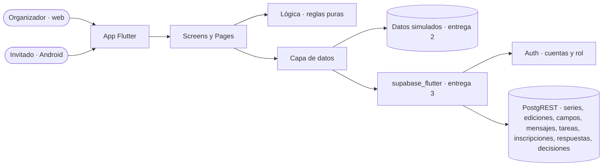

# Architectural spine · ProyectoSeminarioAlvaro

## Resumen

ProyectoSeminarioAlvaro es una app Flutter: el organizador la usa en el navegador del computador y el invitado en su celular Android, con el mismo código.
En la entrega 2 (prototipo) trabaja con datos simulados en memoria; desde la entrega 3 guarda todo en Supabase (Auth y base de datos).
Las recomendaciones no usan IA: son reglas fijas que la app calcula sobre el historial.

## Diagrama

## Stack

- Frontend: Flutter 3.x y Dart 3.x. Plataformas: web y Android.
- Entrega 2: sin paquetes adicionales; los datos salen de `lib/data/mock_data.dart`.
- Entrega 3: SDK `supabase_flutter`.
- Backend: Supabase con Auth y base de datos (Postgres + PostgREST). Storage no se usa.

## Qué cubre cada servicio

- **Auth**: registro, inicio y cierre de sesión. El rol (organizador o invitado) se guarda en la tabla `usuarios`.
- **Base de datos**: las tablas de `docs/modelo.md`.
- **Storage**: no se usa en esta versión.

## Invariantes

### AD-01 · Sin backend propio

- **Regla:** la app habla directo con Supabase; no hay servidor ni funciones propias.
- **Evita:** montar y mantener un servidor para una app ligera.

### AD-02 · Una capa de datos

- **Regla:** las Screens piden los datos a `lib/data/` (entrega 2) o a `lib/services/` (entrega 3). Ninguna Page ni componente lee datos por su cuenta.
- **Evita:** consultas repetidas y distintas regadas por la app, y tener que reescribir pantallas al cambiar los datos simulados por los reales.

### AD-03 · El usuario es el de Auth

- **Regla:** `usuarios.id` es el identificador de la cuenta de Auth; toda inscripción y toda serie guarda ese identificador.
- **Evita:** dos identidades para la misma persona.

### AD-04 · Llaves fuera del código

- **Regla:** la URL y la publishable key se leen de un solo lugar de configuración. La secret key nunca va en la app ni en el repositorio.
- **Evita:** filtrar llaves y cambiar de proyecto editando muchos archivos.

### AD-05 · La lógica no conoce la pantalla ni el backend

- **Regla:** clonar, calcular fechas, llenar plantillas, medir lo reutilizado y recomendar son funciones puras en `lib/logic/`: reciben modelos (y la fecha de hoy como parámetro) y devuelven modelos o resultados.
- **Evita:** reglas que cambian según la pantalla que las llama, y lógica que no se puede probar con `flutter test`.

### AD-06 · Fechas relativas al evento

- **Regla:** tareas y mensajes guardan días respecto al evento (`dias_offset`); su fecha siempre se calcula.
- **Evita:** reprogramar a mano cada tarea y cada mensaje al clonar una edición.

### AD-07 · Clonar copia, no enlaza

- **Regla:** la edición nueva tiene sus propios campos, mensajes y tareas, marcados como heredados, y guarda de qué edición nació.
- **Evita:** que un cambio en la edición nueva altere una edición pasada.

### AD-08 · El pasado no se edita

- **Regla:** una edición cerrada es de solo lectura, y solo las ediciones cerradas alimentan las recomendaciones.
- **Evita:** recomendaciones que cambian porque alguien editó datos viejos.

### AD-09 · Estado local y explícito

- **Regla:** el estado de cada pantalla vive en su Screen; los componentes reciben datos por el constructor y avisan con funciones. No se usan librerías de manejo de estado.
- **Evita:** estado repartido que nadie sabe quién cambia.

## Diferido

- **Storage**: si se agrega una imagen por evento, va en un bucket y la tabla guarda solo la ruta.
- **Seguridad por filas (RLS)**: sin ella, la app filtra por usuario (RNF-08) pero la base no lo impone. Decidir antes de usar datos reales.
- **Edge Functions**: para enviar correos de verdad. Hoy los mensajes se copian.
- **Realtime**: para que varios organizadores hagan check-in a la vez.
- **QR con cámara** y **umbrales configurables** de las reglas.

## Historial

- 0.1.0 · 2026-11-08 · Primera versión.
